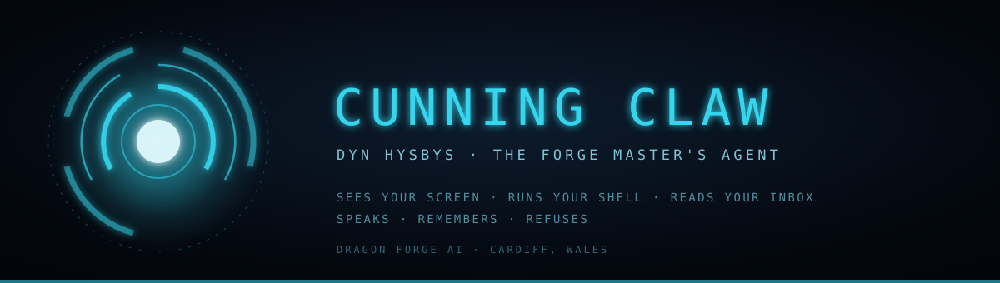
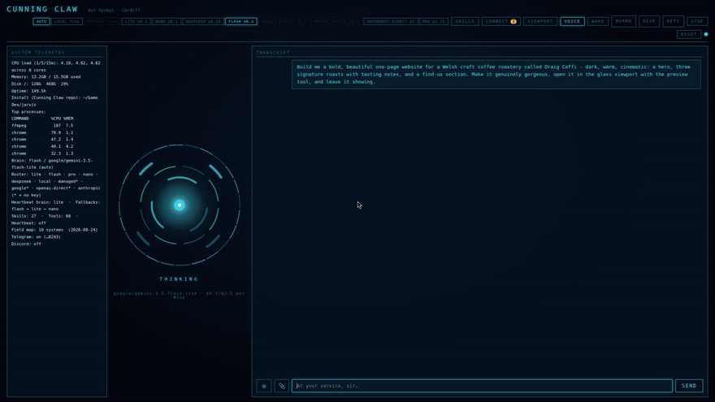

<div align="center">



**Y dyn hysbys — the knowing one.**

A personal AI assistant that runs on your machine and actually operates it.
Sees your screen. Runs your shell. Reads your inbox. Speaks back.
And refuses when a web page tells it to do something you didn't ask for.

<br>


<sub>Built in Cardiff by <b>Dragon Forge AI</b> · Local-first when privacy matters · Human approval when consequences matter</sub>

<br><br>

<a href="https://cunningclaw.com/#demo"></a>

<sub>One take, no cuts: asked for a website, it wrote one and put it on the glass. <a href="https://cunningclaw.com/#demo">The full 42-second film →</a></sub>

</div>

---

## The name

*Cunning folk* is an occupational term, not a flourish. In Wales they were the
**dynion hysbys** — "the knowing ones", singular *dyn hysbys*, literally *the knowing man*.
They worked in villages across Wales into the twentieth century.

They were **tradespeople, not mystics**. You did not visit a *dyn hysbys* for enlightenment;
you brought him a job. Find who took the horse. Read the weather before the sailing. Treat
the child. He worked, you paid.

That is the posture here. Not a companion, not a personality to be enjoyed for its own sake
— **a practitioner you bring a job to.**

The best known were **John Harries and his son Henry of Cwrt-y-Cadno, Carmarthenshire** —
ninety minutes from where this was built. Harries kept the major medical texts of his day
beside Latin and Greek, and practised as physician and astrologer both. His working papers
survive at the National Library of Wales: prescriptions, payment records, horoscopes worked
up on request, correspondence, lecture notes.

A practitioner keeping a record of the work and the reasoning behind each judgement. That is
a case file — and it is a closer description of this software's memory, journal and skills
than the name it used to carry.

*Cunning* cuts both ways, too. A cunning man's trade included telling a client when they
were being had. Which is exactly what this does when a web page tries to give it orders.

→ [`docs/NAME.md`](docs/NAME.md) for the history and sources.

---

## Install

### No terminal: download and double-click

Each tagged release on the [Releases page](https://github.com/Dragon-Forge-master/cunning-claw/releases)
has an installer for your computer — Node is inside, there is nothing else to install:

- **Windows:** `Cunning-Claw-Setup-<version>.exe`. Installs for you alone, no administrator
  password; Start menu entry, an optional desktop icon, and an uninstaller in *Add or remove
  programs* that keeps your keys and memory unless you tick the box.
- **macOS:** `Cunning-Claw-<version>-mac-arm64.dmg` (Apple silicon) or `…-mac-x64.dmg` (Intel).
  Open it and drag **Cunning Claw** into Applications.
- **Linux:** `Cunning-Claw-<version>-linux-x86_64.AppImage` (or `aarch64`). One file: allow it
  to run (*Properties → Permissions → Allow executing file as program*, or `chmod +x`), then
  double-click it. Without FUSE it unpacks itself to a temporary folder instead; if yours
  does not, run it with `--appimage-extract-and-run`.

Your browser opens on the setup page, which walks you through a
[free Google key](#a-free-brain-the-google-key-step-by-step). Your keys, memory and notes live
in your own folder (`%LOCALAPPDATA%\CunningClaw`, `~/Library/Application Support/cunningclaw`,
`~/.local/share/cunningclaw`), so upgrading is installing the new version over the old one.
None of it is code-signed yet, so Windows and macOS ask once before the first run:
on Windows **More info → Run anyway**; on a Mac **right-click → Open**, or on macOS 15
*System Settings → Privacy & Security → Open Anyway*.

Prefer a folder you keep yourself? The same release has a `.zip` / `.tar.gz` of each: unzip
it, double-click **Cunning Claw**, and everything stays inside that folder; `READ ME FIRST.txt`
says what to click. To move an unzipped claw's keys and memory into the installed one, start
the installed one once with `--import <the old folder>` (details, signing and the rest in
[docs/INSTALLERS.md](docs/INSTALLERS.md)). Before a release is published, the Windows
installer, the Apple-silicon `.dmg`, the x86_64 AppImage and the Windows, Apple-silicon and
x64 Linux archives are each installed or unzipped and started on a real Windows, macOS and
Linux machine (`.github/workflows/bundle.yml`). The Arm Linux and Intel Mac builds are not
run before release yet.

### A free brain: the Google key, step by step

Never made an API key? This is the free one, and it takes about two minutes. No card is needed.

1. Open **[aistudio.google.com/apikey](https://aistudio.google.com/apikey)** and sign in with any Google account (your Gmail will do).
2. Accept Google's terms if it asks. Google sets up a project and a key for you; if no key is listed, press **Create API key**.
3. Press the **copy** button beside the key.
4. On Cunning Claw's setup page, paste it into the **Google Gemini** box and press **CHECK & SAVE**. He checks the key with Google before keeping it.

He then runs on Gemini 3.6 Flash through Google directly. Two things to know about the free plan, both from
[Google's pricing page](https://aistudio.google.com/docs/pricing):

- **There is a limit.** Free use is capped per minute and per day. When it is spent he says so in plain words; the daily
  allowance comes back at midnight Pacific time, which is 8 am in the UK. Google shows your own limits at
  [aistudio.google.com/rate-limit](https://aistudio.google.com/rate-limit).
- **Free is paid for with data.** On the free plan Google may use what you send to improve its products. For private work,
  turn on billing in AI Studio (paid use is not used that way), use an OpenRouter key, or choose the offline brain.

### From source

One command from a clean clone:

```bash
git clone https://github.com/Dragon-Forge-master/cunning-claw.git
cd cunning-claw
./install.sh
```

That checks Node 22+, runs `npm install`, creates `.env` from the example, asks for an OpenRouter key, offers the offline voice, runs `npm run doctor`, and prints how to start.

Then `npm run dev` and open **http://127.0.0.1:3900**. It binds to loopback only — nothing is exposed to your network.

No key yet? Start it anyway. With no brain able to run, it opens a **setup page** in your browser instead of
refusing to start: paste an OpenRouter or Google key (checked with the provider for free before it is kept),
or choose the offline brain if Ollama is running, then give your name and town. Those live in
`data/owner.json`, not in `claw.config.json`, so `npm run update` never trips over your edits.

### Windows (native)

Install [Node 22+](https://nodejs.org) and [Git](https://git-scm.com/download/win), then in PowerShell:

```powershell
git clone https://github.com/Dragon-Forge-master/cunning-claw.git
cd cunning-claw
powershell -ExecutionPolicy Bypass -File .\install.ps1
npm run dev
```

`install.ps1` mirrors `install.sh`: Node check, `npm install`, `.env` with a no-echo key
prompt, workspace seeding, `npm run doctor`. No Piper voice on Windows yet — he types.

Windows is the youngest platform: coded and doctor-checked, but the least field-tested —
that is why the badge says beta. If you want the full Linux experience on a Windows
machine (voice included), install under **WSL2** instead and follow the Linux steps.

### Autostart (Linux)

CUNNING CLAW is meant to survive a closed terminal. `install.sh` can drop a **systemd --user** unit (not a system unit — it needs your session for X11, audio and Chrome):

```bash
systemctl --user enable --now cunningclaw
loginctl enable-linger $USER    # still running after logout
```

The template lives at `packaging/cunningclaw.service`. macOS: keep `npm run dev` in a Terminal at login, or a LaunchAgent if you add one later.

### By hand

```bash
npm install
cp .env.example .env        # add your OPENROUTER_API_KEY
./setup-voice.sh            # neural voice, ~60MB, fully offline
./setup-ears.sh             # private ears: whisper.cpp + ggml-base.en.bin (~150MB), so the mic
                            # is transcribed here — without it the browser's recogniser sends
                            # your voice to Google, and the HUD says BROWSER EARS
npm run doctor
npm run dev
```

### Updating

Installed from a release? Install the new version over the old one; your own folder is not
touched. From source, one command, same on every platform:

```bash
npm run update
```

That is `git pull` plus `npm install`, run by npm in its own shell — so it works
identically in PowerShell, which does not accept `&&` on older versions, and in
bash, which does. Your `.env`, your `data/` (memory, journal, history) and your
workspace are untracked and survive every update untouched.

Then relight it: `systemctl --user restart cunningclaw` if you use the autostart
unit, or Ctrl+C and `npm run dev` again in a plain terminal. The claw tells you
its version in the boot banner, and `npm run doctor` after an update names
anything new it wants.

**The update light.** He can check once a day whether a newer version is out, but only if
you say yes: the setup page asks, and an install that never answered is asked once on the
HUD. A check is one request for one small file, `https://cunningclaw.com/latest.json`,
carrying nothing about you or your claw (not even his version); until you answer, and
after a no, nothing is sent. When a newer version is out the version beside the logo turns
amber — `v0.5.1 · update ready: v0.5.2`, or red-amber for a security update — and clicking
it shows what is new, the release notes, and how to update this install: the matching
installer or archive, or `npm run update` for a clone. It never downloads or installs
anything itself. The same panel has **Check now**, the daily on/off, and, if a phone line
is set up, a one-message-per-version note to your phone that you can turn off on its own.
What the request carries, and why, is in
[docs/SECURITY-ARCHITECTURE.md](docs/SECURITY-ARCHITECTURE.md) (section 4.1).

If `git pull` refuses because you have edited tracked files, either keep your
edits (`git stash`, update, `git stash pop`) or take the fresh-clone road: rename
the old folder aside, clone anew, copy `.env` across from the old folder, and
`npm install`. Nothing is lost — the old folder holds everything until you
delete it yourself.

### Name your claw

The software is Cunning Claw. *Your* claw answers to whatever you put in
`claw.config.json`:

```json
"persona": {
  "name": "Cunning Claw",
  "addressUserAs": "sir",
  "userName": "Owner"
}
```

`name` is what it calls itself — in its own head, and when it announces itself
on Telegram or Discord. `addressUserAs` is what it calls you; `userName` is who
it understands you to be. Edit them, then relight (restart, as in
[Updating](#updating)) — config is read once at boot. The HUD wordmark, the
boot banner and the repo stay Cunning Claw: that is the software's name, the
way the tin keeps its label whatever you christen what's inside.

Only you can do the christening. The identity files (`SOUL.md`, `IDENTITY.md`,
`HEARTBEAT.md`) raise an approval card on every write, and no plan may
pre-authorise touching `claw.config.json` — so no web page, no email, and no
approved plan can rename your claw behind your back.

Yours to name. Ours to answer for.

### Telegram and Discord

Both optional, both a second phone line to the same butler: you message it, it
replies, and approval cards arrive as buttons. Nothing is listened to until an
allowlist exists — a leaked token alone cannot be talked to by strangers.

**Telegram** — make a bot with @BotFather, put its token in `TELEGRAM_BOT_TOKEN`,
message it `/whoami`, and put the id it replies with in `TELEGRAM_CHAT_ID`.
You can add a group's id too, but a group is a room, not a person: only you are
obeyed there (by your Telegram user id), strangers get silence, approval cards
go only to your private chat, and replies in the group have paths, the
hostname and LAN addresses taken out.

**Discord** — in the [Developer Portal](https://discord.com/developers/applications):
New Application → Bot → Reset Token (that is `DISCORD_BOT_TOKEN`). On the same
page, under *Privileged Gateway Intents*, turn on **Message Content** — without it
the bot hears silence. Under OAuth2 → URL Generator tick `bot`, then *Send
Messages* and *Read Message History*, and open the URL to invite it to your server.
Message it `/whoami` and put your user id in `DISCORD_ALLOWED_USER_ID`.
Approval cards and the boot greeting go only to a DM with each allowlisted user,
never to a server channel, and a button press counts only in a DM. Replies in a
server channel have paths, the hostname and LAN addresses taken out.

There is also a **managed brain** in the catalogue (`id: managed`) for the
forthcoming Just Works subscription — inert without a `DRAGONFORGE_TOKEN`; see
[`docs/RETAIL.md`](docs/RETAIL.md). Bring-your-own-key remains free forever and
never crippled.

Only the allowlisted ids are heard, and only they can press EXECUTE. Everything
sent out is redacted first, and the bot cannot @-mention anyone, so a hostile page
summarised into a reply cannot make it ping your server. `npm run doctor` reports
both lines.

**Voice notes (Telegram).** Send a voice note and he hears it on this machine —
ffmpeg turns Telegram's OGG/Opus into audio for the same private ears the HUD's mic
uses (whisper.cpp) — shows you `🎙 heard: …` and runs it as if you had typed it.
The reply always comes as text; a voice note follows when `/voice` says so: `off`,
`when I speak` (the default) or `always`. The voice reads exactly the text that was
sent, redacted, so it cannot say what the text was cleaned of. **A voice note never
answers an approval card** — while one is open a voice note is not even fetched, so a
misheard "yes" cannot become EXECUTE. A stranger's voice note is ignored like their
text, and never downloaded. Needs `ffmpeg` with libopus and the ears
(`./setup-ears.sh`); spoken replies need Piper (`./setup-voice.sh`). `npm run doctor`
names whichever is missing, and so does the bot. Tested here with stand-ins for
Telegram, whisper and Piper, and a real ffmpeg round trip; not yet with a live bot.

**Receipts.** Send a photo captioned "receipt" and it is filed, with no conversation
in between: kept under `data/receipts/`, read by a vision brain (`receipts.visionBrain`,
else your first trusted brain — so the photo goes to that provider) into date,
supplier, total and VAT in whole pence, category and payment, and added to
`ledger.json` and `ledger.csv`. The Desk's Receipts page is rebuilt from the ledger.
He tells you exactly what he filed; `fix that: total £12.40` corrects it as typed,
with no model in between, and the old value stays in that receipt's history. The
`receipts` tool lists or exports a date range as CSV or JSON. A receipt was printed by
a stranger, so only the documented fields are kept, a supplier cannot become a
spreadsheet formula, and the receipt tools pin the turn to a trusted brain. A
bookkeeping aid, not an accountant.

### ntfy

A third way to reach your phone, with no account at all: [ntfy](https://ntfy.sh)
(free app, iOS and Android). It is outbound only — the claw listens on
127.0.0.1, which your phone cannot reach — so it tells you things but takes no
orders: briefings and other scheduled results, heartbeat alerts, remote jobs
finishing, `notify` with `to: phone`, and an alert when an approval has waited
15 seconds unanswered. That alert names the action, never the command, and has
no buttons; you answer on the HUD, Telegram or Discord.

1. Install the ntfy app and subscribe to a new topic with a long random name —
   `npm run doctor` suggests one.
2. Put that name in `.env` as `NTFY_TOPIC=`.
3. Restart the claw. `npm run doctor` and the HUD status panel show it as on.

**A public ntfy.sh topic is readable by anyone who guesses its name.** The name
is the only lock, so treat it like a password, and know that everything sent is
redacted, has paths, the hostname, LAN and email addresses taken out, and is cut
short. For a private line, run your own ntfy server (`ntfy.server` in
`claw.config.json`) or use a protected topic with an access token in `NTFY_TOKEN`.

### Pocket Claw (your phone, through Tailscale)

The claw's own phone app, added to your home screen from Chrome: talk to him,
answer approval cards with your fingerprint, snap a receipt, see mission control's
jobs, or share a photo or PDF to him from any app. The claw still listens on
`127.0.0.1` only. Your phone reaches it through [Tailscale](https://tailscale.com),
a private network of your own devices:

1. Install Tailscale on this machine and on your phone, signed in to one account.
2. In Tailscale's admin console, turn on MagicDNS and HTTPS Certificates.
3. On this machine: `tailscale serve --bg 3900`.
4. On the HUD, press **POCKET**, save the name `tailscale serve status` shows
   (`your-pc.your-tailnet.ts.net`), press **PAIR A PHONE** and scan the code.

On that name the claw serves Pocket and nothing else: no HUD, no Keys page, no
`/api`. The token the phone gets opens the list of waiting cards; reading or sending
needs a fingerprint in the last ten idle minutes; approving needs a fresh fingerprint
for *that* card. Notifications say how many cards wait, never what is on them.
**REVOKE** on the POCKET panel ends a phone at once. The full setup, the security
model with the test behind each claim, and a Cloudflare Tunnel alternative are in
[docs/POCKET-CLAW.md](docs/POCKET-CLAW.md).

Honesty: Pocket has been driven in Chromium emulating a Pixel 7, with a virtual
passkey, against a private claw. It has **not yet been run on a real phone or
through a real tailnet**. iPhone is untested, and iOS cannot share files to a web app.

### The house (Home Assistant)

Lights, heating, blinds, music, scenes, locks and the doorbell all go through
[Home Assistant](https://www.home-assistant.io) — Ring included, through HA's Ring
integration; the claw has no device clients of its own.

1. In HA: your profile → Security → Long-lived access tokens. Put the token in
   `.env` as `HA_TOKEN=`.
2. In `claw.config.json`: `homeAssistant.enabled: true` and `baseUrl` (e.g.
   `http://homeassistant.local:8123`).
3. `npm run doctor` says whether HA answers and accepts the token.

`home_assistant` reads the house (`status`: who is home, heating, lights on,
what is open, alarm, last doorbell) and calls one service on one entity, with
service data checked per domain — brightness 0–100 %, heating 5–30 °C, and so
on; a key that is not on the list is refused with the list. Comfort asks the
usual way. **Unlocking, disarming or arming, garage doors, gates and sirens ask
with a fresh card every time** — no work order or "allow for this task" covers
them — and are refused outright in a turn that has read text trying to give
instructions. HA administration, shell commands and alarm codes are never passed.

**Live events.** `homeAssistant.watch` (empty by default) lists entities to hear
over HA's WebSocket — a doorbell press, motion, a door opening, someone arriving
or leaving — with `notify` (phone, hud or both), an optional `snapshot` camera,
`quiet` hours and a per-entity `debounceMinutes`. Events go to the HUD and to
Telegram/Discord DMs; ntfy gets text only, never a picture. An event is told,
never acted on. Each one is a line in `Visitor log.md` on the Desk; stills stay
in `data/visitors/` on this machine, and both are deleted after
`visitorRetentionDays` (30).

**No face recognition.** A visitor is a time, an optional local still and — only
with `describeVisitors: true` — one generic caption ("one person holding a
parcel"). Nobody is identified: a doorbell camera sees the street, the ICO's
guidance puts that recording under UK GDPR, and recognising a face is biometric
identification, special-category data. Who is home comes from HA's own `person.*`
entities. The house skill (`workspace/skills/house-control`) has the details and
example rules.

Runs on **Linux** (`xdotool`, `wmctrl`, `pactl`, `paplay`), **macOS** (`screencapture`, `osascript`, `pbcopy`, `afplay`/`say`) and **Windows** (PowerShell — nothing to install). Missing tools return a message naming what to install, never a silent no-op. See the platform table below.

```

                                                                       ▄▀  ▄▄   
                                                                    ▄▄▀   ▄███  
   ▄███▄ ▄█   █▄ █▄  ▄█ ██   █ ▄█ ██   █  ▄███▄                  ▄▄█▀    ████▀  
   ██▀██ ██   ██ ██  ██ ██   █ ██ ██▄  █  ██▀██▄          ▄▄█▀█████▀     ███    
  ██   █ ██   ██ ██▄ ██ ███  █ ██ ███  █ ▄█   ██         ██▀██▀▄█▀▀ ▄▄▄  █▄     
  ██     ██   ██ ███ ██ ███  █ ██ ███  █ ██             █ █▀▀▄██▀▄▄▀▀▀▀▀  ▀▀    
  ██     ██   ██ █▀█ ██ █▀█▄ █ ██ ████ █ ██  ▄▄▄  ▄▄▄▄▄▄██▄███ ██▀▄█████████████
  ██     ██   ██ █ ████ █ ▀█ █ ██ ██▀█ █ ██  ███   █████▄ ████▄▀▄███████████▀▀▀ 
  ██   ▄ ██   ██ █ ▀███ █▄ ███ ██ ██ ███ ██  ▀▀█     ▀███████▄▀▀████████▀▄▄█▀   
  ██   █▀ █   █▀ █  ███ ██ ███ ██ ██ ███ ▀█   ▄█           ▀▀███████▀██▄▀███    
   ██▄██  ██▄██  █  ███ ██  ██ ██ ██  ██  ██▄███              ████████▀▀▀▀      
   ▀███▀  ▀███▀  █   ██ █▀  ██ ██ ██  ██  ▀███▀              ▄█████████▄        
                                                          ▄▄█████████████▄▄     
                                                          █████▀▀   ▀▀█████     

  ──────────────────────────────────────────────────────────────
  CUNNING CLAW  ·  y dyn hysbys  ·  v0.5.0
  Yn lleol yn gyntaf · Caniatâd dynol pan fo canlyniadau
  (local first · human consent where there are consequences)

  ▸ ar-lein  http://127.0.0.1:3900   the glass is lit
  ▸ brain    flashlite · google/gemini-3.1-flash-lite
  ▸ llais    piper · en_GB-alan-medium   (the voice)
  ▸ curiad   every 30m   (the heartbeat)
  ▸ offer    83 tools on the bench

  ▸ wards    y ffens   — outside words are fenced
             y llw     — consequences wait for you
             y sarff   — the serpent watches the loop

  “Dyfal donc a dyr y garreg.”
    — Steady tapping breaks the stone.  · arysgrif y dydd

  At your service, sir.
```

<div align="center">
<br>
<!-- SCREENSHOT: the HUD at rest — arc reactor, telemetry panel, empty transcript -->
<sub>The HUD: arc reactor, live telemetry, transcript, approval cards.</sub>
</div>

---

## What it does

| | |
|---|---|
| **Sees** | Screenshots the desktop, and can *glance* at the room through a webcam or a Home Assistant camera — mood is a hypothesis, never a reason to act |
| **Runs the house** | Home Assistant: lights, heating, blinds, scenes; hears the doorbell and the doors — security actions ask every time, and nobody is identified |
| **Operates** | Shell, files, apps, volume, media, clipboard, notifications, window focus, keystrokes |
| **Browses** | Owns a Chrome profile over CDP — accessibility refs, real mouse/keys, snapshot after every action, Gmail, Outlook on the web, WhatsApp Web |
| **Reads documents** | PDF, Word, Excel, PowerPoint, OpenDocument, HTML, CSV and images (OCR). Office files open with nothing installed; `markitdown`, `pdftotext` and `tesseract` add PDFs and scans — `npm run doctor` names the install line. What comes back is fenced as a stranger's words |
| **Reads mail** | Gmail or Outlook on the web (Microsoft 365, Outlook.com, Hotmail) through that Chrome session — search, category tabs or Focused / Other, whole threads, drafts. Send is always an approval, through the same consent check for marketing. No credentials handled |
| **WhatsApp** | WhatsApp Web / Business in the same Chrome — chat list, title unread count, draft, send. Send is always an approval. QR is scanned in that window |
| **Markets** | The desk-marketer skill: follow-ups after a job, review requests, MOT and service reminders, newsletters in the business's own voice, prepared on a schedule, designed in Canva, sent through Resend, MailerLite or Klaviyo once you approve, with a report after. Who may be mailed is a consent register on the Desk, checked in code at every send — unknown, opted-out or basis-less recipients are removed or the send is refused, and a marketing email with no unsubscribe line does not go |
| **Accounts** | Jurisdiction packs (UK first; IE, US, AU, DE as stubs) plus Xero via the official local MCP. It will not invent a foreign tax rate or file a return |
| **Speaks and listens** | Neural TTS (Piper), offline. Push-to-talk transcribed on this machine by whisper.cpp once `./setup-ears.sh` has run; until then the browser's recogniser hears, and the HUD says so. The "Claw" wake word works with the browser's ears only, for now. Telegram voice notes are heard by the same local ears, and can be answered in voice |
| **Keeps receipts** | A photo captioned "receipt" (Telegram) or snapped in Pocket Claw is read into a ledger in whole pence — date, supplier, total, VAT — with a CSV/JSON export and corrections typed in plain words. Filing never starts a conversation with what the slip says |
| **Reads kindly** | **Aa** on the HUD switches every page to OpenDyslexic, bundled so it works offline. Code and commands stay monospace. The choice is saved per install |
| **Finishes projects** | Research reports with a dated source log, grant and tender bids mapped to the scoring, decks, project plans — drafted on the Desk from your real facts, gaps marked `[NEEDED: …]`, then printed to PDF by Chrome (`export_pdf`: A4, or one 16:9 page per slide). It never invents evidence and never submits; you do |
| **Remembers** | Markdown memory and a dated journal that survive restarts, searched by meaning as well as by words |
| **Watches** | A 30-minute heartbeat that stays silent when there's nothing worth saying |
| **Reaches you** | Telegram or Discord, so it isn't trapped at your desk — approval cards arrive as buttons you press, in a private chat only. **Pocket Claw**, its own phone app over Tailscale, answers cards with your fingerprint. ntfy for a push alert with no account |
| **Codes** | `delegate_code` hands a coding job to Claude Code, headless, in a fresh git worktree and branch of a project you named in config — after a card showing the exact brief. It never pushes or merges; you review the branch. A **JOBS** sheet on the HUD is mission control for it |
| **Works elsewhere** | Any other machine you own over ssh — a spare PC or a cloud VM. Long jobs run **detached**: builds and servers survive the conversation ending and your laptop closing, which they cannot do here |
| **Connects** | 95 MCP connectors from one sheet. **Guide me** on any card and he walks you through setting it up, one step at a time, from the same catalogue — then offers to save how you like it used as a skill |
| **Teaches** | **Learn mode**: a course inside the claw in operating it safely — twelve lessons, and practice on fake email where every card is marked PRACTICE and nothing real happens |
| **Extends** | Skills as `SKILL.md` files ([agentskills.io](https://agentskills.io)). Click **SKILLS** on the HUD to arm them, the same idea as Claude’s capabilities list |

<div align="center">
<br>
<!-- SCREENSHOT: a turn using tools — tool chips, then a reply -->
<sub>Tool calls stream into the transcript as they happen.</sub>
</div>

---

## Platforms

| | Linux | macOS | Windows |
|---|---|---|---|
| Shell, files, browser, email, HTTP, MCP | ✅ | ✅ | ✅ |
| Screenshots | `gnome-screenshot` / `ffmpeg` | `screencapture` | PowerShell + System.Drawing |
| Webcam glance | `ffmpeg` + `/dev/video0` | `ffmpeg` + avfoundation | not wired yet |
| Windows, keystrokes | `wmctrl`, `xdotool` | `osascript` | PowerShell SendKeys |
| Clipboard | `xclip` | `pbcopy` | `Get-/Set-Clipboard` |
| Notifications | `notify-send` | `osascript` | balloon tip |
| Voice | Piper → `paplay`, or espeak | Piper → `afplay`, or `say` | Piper → PowerShell, or Windows SAPI |
| Volume | `pactl` | `osascript` | media keys (no absolute level) |

Windows needs nothing installed for the desktop tools — PowerShell ships with the OS.
Each platform's paths live in `src/platform.ts`, `src/windows.ts` and `src/desktop.ts`;
a missing tool always produces a message naming the fix, never a silent no-op.

**Butler eyes.** `look` takes one still from the desk webcam, or from a Home
Assistant `camera.*` entity. It is on in `claw.config.json` (`eyes.enabled`,
device `/dev/video0` on Linux). Mood is a hypothesis, never a diagnosis and
never a reason to act without asking. Not a live stream. Not a heartbeat.
Frames are not kept.

Honesty about maturity: **Linux** is where CUNNING CLAW lives every day. **macOS** and
**Windows** are coded and doctor-checked but far younger — expect rough edges, and please
report what you find. Native install on Windows is `install.ps1` (see Install above).

> **Honesty about testing:** Linux is exercised daily. Windows has been run on real
> hardware by the author and works, but has had far fewer hours — hence the beta badge.
> macOS is written against the documented APIs with its pure logic unit-tested and has
> not been run on a real Mac yet. If you try one, please open an issue with what broke.

## Run it offline

Every brain is swappable. Point one at a local runtime and nothing leaves the machine —
no API key, no account, no network.

```bash
ollama pull llama3.2
```

```jsonc
// claw.config.json — this brain ships already configured
{ "id": "local", "provider": "openai", "model": "llama3.2:latest",
  "baseUrl": "http://localhost:11434/v1" }
```

Then `/brain local` in the HUD. Ollama, llama.cpp, LM Studio and vLLM all serve the same
API; loopback and private-range hosts skip the key check entirely.

> **One caveat, stated plainly.** Resisting a prompt injection is model *behaviour*, not a
> code guarantee, and small models are measurably worse at it. So turns that can see
> untrusted content are forced onto a trusted brain — see below. Offline is for privacy and
> cost, not for handing your inbox to a 7B model.

## Memory

`memory_save` keeps a fact; `memory_search` finds it again. Search works two ways at once:

- **By words**, with no network: every word of the question counts on its own, in any
  order, through plurals and *-ing*, so "Pontypridd paint repair" finds "mobile paint repair
  in Pontypridd".
- **By meaning**, when an embeddings provider is available: "the car spraying job" finds
  the same fact with no word in common. Vectors are cached in `data/memory-vectors.json`
  and re-made only for a memory that was edited, or when the model changes.

```jsonc
// claw.config.json — optional; "auto" is the default
"memory": { "embeddings": "auto" }   // "gemini" | "openrouter" | "ollama" | "off"
```

**Where your memories go.** Memory text is sent to an embeddings provider only if you have
keyed that provider — Gemini (`GEMINI_API_KEY`, model `gemini-embedding-001`) or OpenRouter
(`OPENROUTER_API_KEY`, `openai/text-embedding-3-small`) — and it is redacted first. With
`"ollama"` (`ollama pull nomic-embed-text`) nothing leaves the machine, and `"auto"` picks
Ollama by itself when your default brain is local. If the provider is down, unkeyed or
`"off"`, search falls back to words alone and says why in the log; it never fails.

---

## A second machine

`run_command` waits for a command to finish and stops it at the timeout. That is
right for a desk machine and it means one thing plainly: **servers, builds, watchers
and long scrapes cannot run here at all.** The code says so to the model itself.

A box fixes that. Point Cunning Claw at any other computer you own — a spare PC, an
EC2 instance, a GCE VM, a Hetzner or DigitalOcean droplet, Oracle's free tier — and
he can work on it.

```jsonc
// claw.config.json
"remote": {
  "defaultBox": "forge",
  "boxes": [{
    "id": "forge",
    "label": "Build box",
    "host": "203.0.113.10",
    "user": "claw",
    "identityFile": "~/.ssh/claw_forge",
    "workdir": "/home/claw/work"
  }]
}
```

Three tools: `remote_run` for something short, `remote_job` for anything long, and
`remote_copy` for files. A started job is **detached** — it survives the turn, the
conversation, and Cunning Claw restarting. Close the laptop; the build carries on.
The Forge Board grows a **floor** panel showing every box and what is running on it.

Transport is plain `ssh`, shelled out to the system binary. No provider SDK, no new
dependency, works with every cloud and every spare machine — and the private key is
read by `ssh` itself, so it never enters this process's memory.

**The safety rules are not decoration:**

- **The model never supplies a host, a user, or an ssh option.** Boxes are chosen by
  id from your config. `-o ProxyCommand=…` is local code execution; it is unreachable
  because nothing model-supplied reaches the argv.
- `BatchMode=yes`, `StrictHostKeyChecking=yes`, `ForwardAgent=no`. You verify the host
  key once, by hand — automating that away deletes the only proof of *which machine*
  you are talking to.
- **The same command floor applies out there.** `rm -rf` is refused on a box exactly
  as it is here. `sudo` and `reboot` are per-box opt-ins, and even then they ask.
- **Everything a box prints is untrusted and redacted** — a build log is other people's
  code talking — and a turn that touches a box takes a trusted brain.
- **The box holds no secrets and receives none.** `remote_copy` refuses the
  sensitive-file denylist on *both* sides — it will not push your `.env` to a box
  and will not fetch the box's own keys back. Remote paths are whitelisted
  characters only (a path is not a place for `;` or `$()`), and the box is asked
  where a path really resolves before anything moves, so a symlink out of the
  working directory is refused. A pull is a local write, so it obeys the same
  guards `write_file` does: it can never land on `SOUL.md`, `SCHEDULE.md` or
  `claw.config.json`, and it leaves an undo snapshot.

**Finished jobs find you.** A watcher checks running jobs every 45 seconds and reports
completions on its own — the claw tells you the build finished while you were asleep,
rather than waiting to be asked. The fact (exit code) is stated plainly; the log is
fenced as untrusted, because a build log is other people's code talking.

Setup is one command each: make the key, copy it over, `ssh user@host true` once to
verify the fingerprint, then add the block above. `npm run doctor` checks every box —
reachable, key present, key mode, host key known, workdir writable — and names the fix
for each failure.

> A box is **not** a sandbox. It has *less* protection than your own machine: no undo
> snapshots, and the sensitive-path denylist cannot follow you onto it. Treat it as a
> machine you would not mind rebuilding.

---

## Coding jobs: the foreman

The claw is a good dispatcher and an indifferent programmer; Claude Code is the
reverse. So a real coding job — read a codebase, change it, run its tests — is handed
over: `delegate_code` briefs Claude Code, runs it headless (`claude -p`), watches it,
and tells you when it is done.

```jsonc
// claw.config.json
"foreman": {
  "projects": [{ "id": "site", "label": "The shop's website", "path": "~/code/shop-site" }]
}
```

Install Claude Code (`curl -fsSL https://claude.ai/install.sh | bash`), run `claude`
once to sign in, add a project, and `npm run doctor` says whether it is ready. Jobs
are billed to that Claude Code sign-in, not to the claw's own key.

- **Projects are chosen by id.** The model never supplies a path or a flag, and the
  brief reaches Claude Code on stdin, so a brief that begins with a flag is prose.
- **Every start is a card** with the exact brief, the project, the branch and the
  permissions. No plan or "allow for this task" covers it.
- **Refused after outside text.** Once the conversation has read a web page, an email
  or a document, `delegate_code` refuses, before any card, and says why: a stranger's
  words must not become code that runs here.
- **A fresh worktree and branch each time**, beside the project, never in your
  checkout. Nothing is pushed or merged; you review the branch and merge it yourself.
- **A short leash.** Edits only inside the worktree (and any folder the project adds in
  config); by default a shell limited to the test, type-check and read-only git
  commands; no web and no connectors; hooks off unless you turn them on; none of the
  claw's keys in its environment; a turn limit and a wall-clock limit from config.
  `npm test` is still code execution — the job can edit the test script — and the
  job is not inside the shell's sandbox, so the card is the boundary.
- **What comes back is fenced.** Claude Code read the project's files, so its summary
  is treated as a stranger's words.

The HUD's **JOBS** sheet (and the `jobs` tool) is mission control: each job's state,
one status line, Cancel. Today the foreman's jobs are what it lists.

Honesty: every rule above is tested against a stand-in Claude Code, and the argv was
checked once against the real CLI. **A real coding job has not yet been run end to
end.**

---

## Google, the easy way

There is no Google card on the connectors sheet, and that is not an oversight.
Google publishes no hosted MCP for Gmail, Calendar or Drive, and the community
servers that exist all require you to create your own Google Cloud project and
OAuth credentials first — a wall nobody should have to climb to read their
own mail.

So the claw takes the other road: **it uses Google the way you do — through a
browser you are signed into.** Once:

1. Ask the claw to open Gmail (or open the browser viewport and go there).
2. Sign in, in that window. The session belongs to the claw's own Chrome
   profile on your machine and persists like any browser login.

From then on the built-in tools do the rest: `check_email` reads your inbox,
threads open and get read in full, and Gmail keyboard actions (archive, reply,
and friends) work the real page. Calendar, Drive, Docs and YouTube are the
same story — signed in once, they are all the claw's hands. Nothing about
your Google account is stored outside that browser profile, and everything it
sends still stops for your approval first.

A one-click "Sign in with Google" connector card — one OAuth app registered
for everyone — is on the retail roadmap; Gmail's API scopes require a paid
third-party security assessment, so the browser road stays the honest default
until the subscription pays that bill.

## Outlook, the same way

Plenty of businesses run on Microsoft 365 rather than Google, and Outlook on the
web works through the same road: the claw's own Chrome, signed in once, no keys and
no app to register. Choose it once in `claw.config.json`:

```json
"email": { "provider": "outlook", "outlook": "work" }
```

`"work"` is a work or school account on Microsoft 365 (outlook.office.com);
`"personal"` is Outlook.com or Hotmail (outlook.live.com). Without an `email`
setting the tools open Gmail, as they always have, and a single job can name the
other mailbox. Then ask the claw to check your email, and sign in with your
Microsoft account in the window that opens — `connector_guide "outlook"` walks
through it, and `npm run doctor` says which mailbox is set.

The same five tools do the work: `check_email` (Gmail-style searches are turned into
Outlook's, and anything with no Outlook equivalent is named rather than dropped
quietly), `read_email`, `draft_email` (types, never sends), `send_email` (always a
card, and the same consent check for marketing) and `email_action` (archive, read,
unread and flag run freely; delete to Deleted Items asks). The claw presses Outlook's
buttons by their accessible names and uses Outlook's keyboard shortcuts only when a
button is not there; when Microsoft changes the page, it says which part it could
not find instead of reporting an empty inbox.

Honesty: this was built and tested against a local page that imitates Outlook's
accessibility structure, driven in a real Chromium. **It has not yet been run against a
real outlook.office.com or outlook.live.com mailbox.** Calendar and OneDrive need
the Microsoft Graph connection planned in
[docs/OUTLOOK-GRAPH-PLAN.md](docs/OUTLOOK-GRAPH-PLAN.md).

## MCP

Cunning Claw speaks the same `mcpServers` files Claude Code and Cursor use, over the
same transports: **stdio** (a local subprocess) and **Streamable HTTP** (a remote URL,
with `Mcp-Session-Id` and `MCP-Protocol-Version: 2025-03-26`). That is how Canva, Slack, HubSpot, Notion, Figma, and the rest of the hosted
catalogue work — not a one-shot POST.

The HUD **CONNECT** button is the directory: Popular cards, category chips
(Create, Code, Work, Docs, Chat, Money, Data, Ship, Search, Sales, Automate,
Meetings, AI), All / Connected / Not connected, search, and Reconnect when a
server needs sign-in. Seeing a name in the list does **not** connect it.
Connect writes `~/.config/cunningclaw/mcp.json`. You can still paste a Claude
snippet under ADD, or keep servers in the files below.

Put servers in any of these (first id wins):

1. `claw.config.json` → `mcp.servers`
2. `~/.config/cunningclaw/mcp.json` (the one to copy snippets into)
3. `<this install>/.mcp.json`
4. `~/.claude.json` (Claude Code user-scope, plus a matching project block)
5. `~/.cursor/mcp.json`

Canva is a hosted server. Nothing to install. Copy `docs/mcp.example.json` to
`~/.config/cunningclaw/mcp.json`, restart, then in the HUD: *connect Canva*.
`mcp_login` opens the **system** browser for OAuth (PKCE + dynamic registration)
and listens on `127.0.0.1`. Sign-in is never started at boot — systemd has no
browser. After that, tools show up as `mcp__canva__…`.

If Canva (or another vendor) only allowlists Claude/ChatGPT as OAuth clients,
use the stdio bridge instead (`docs/mcp.canva-remote.example.json`). Same tools,
local `mcp-remote` process, its own browser dance.

```jsonc
{
  "mcpServers": {
    "canva": { "type": "http", "url": "https://mcp.canva.com/mcp" }
  }
}
```

The older `claw.config.json` array still works:

```jsonc
"mcp": {
  "enabled": true,
  "servers": [
    { "id": "github", "transport": "stdio",
      "command": "npx", "args": ["-y", "@modelcontextprotocol/server-github"],
      "env": { "GITHUB_TOKEN": "${GITHUB_TOKEN}" } }
  ]
}
```

`${VAR}` and `${VAR:-default}` expand in command, args, env, url, and headers.

Tools arrive namespaced (`mcp__github__create_issue`) so a server cannot shadow a built-in.
Those tools, **with their JSON Schemas**, are sent to every brain — Anthropic and the
OpenAI-compatible ones (Gemini Flash/Pro, nano, local Ollama). `mcp_status` lists each
tool and its required arguments; `mcp_schema` returns the full input schema so the
assistant does not have to guess `prompt` vs `input.prompt`. Call results come back as
JSON (`ok`, `text`, `json`, `structured`, `resources`) inside `<untrusted>`. Flattened
arguments are repaired to the schema before the server sees them.

The client is hand-rolled — MCP is JSON-RPC, and the official SDK brings ten dependencies
into a project that has two.

**Connecting to a server is a trust decision, so servers come from config only, never
discovery.** A stdio server is a subprocess you spawn — that is arbitrary code execution.
Three consequences are handled for you: tool *descriptions* are written by the server and
reach the system prompt, so they are sanitised and length-capped; tool *results* are
attacker-controlled and come back `<untrusted>`-fenced; and any MCP call taints the turn,
so it can never be handled by a cheap brain. Writes are approval-gated unless you list them
as read-only. Ask `mcp_status` any time.

## Authentication

Binding to loopback keeps CUNNING CLAW off your network. It does **not** keep it away from your
machine — any process running as you could otherwise POST to `/api/chat` and get a shell,
a file write, or your inbox. Loopback is not a permission boundary.

A token is generated on first run and written to `.env` (mode 600). Three checks, because
no single one covers every caller:

- **Bearer token** for scripts: `Authorization: Bearer $CLAW_TOKEN`
- **A session cookie** (`HttpOnly`, `SameSite=Strict`) issued when you load the HUD —
  `EventSource` cannot set headers, so the event stream has no other way to authenticate
- **An Origin check** on state-changing requests, so a page you happen to be visiting
  cannot ride that cookie

```bash
curl -H "Authorization: Bearer $CLAW_TOKEN" http://127.0.0.1:3900/api/status
```

Opening `http://127.0.0.1:3900` in a browser needs nothing — the cookie is issued on load.

**And every request must name this claw.** A DNS-rebinding page reaches `127.0.0.1`
under its own name, and once got the session cookie that way. Now the first thing
that runs is a host gate (`src/pocket-host.ts`): `localhost`, `127.0.0.1` and `::1`
with no proxy in between get the HUD; your Pocket Claw name gets the phone app and
nothing else; any other name is refused with `421` before a route runs.

> **If you set `server.host` to `0.0.0.0`** to reach the HUD from another computer, that
> stops working: a request to the machine's LAN address is refused. That is the point.
> Use Pocket Claw for your phone, or `ssh -L 3900:127.0.0.1:3900` from another computer.

## Safety

The full write-up — threat model, each layer with its code, worked attack scenarios, and the known gaps — is
[docs/SECURITY-ARCHITECTURE.md](docs/SECURITY-ARCHITECTURE.md).

Most assistants in this category will run whatever the model emits. This one is built on the
assumption that the model will eventually be lied to.

**Enforced in code — holds on any model, cannot be weakened by config:**

- A **hard denylist floor**. `rm -rf`, `mkfs`, `dd` to a block device, fork bombs, `curl | sh`,
  reads of `/etc/shadow`. Config can add to it, never subtract.
- **Approval gates** on everything that changes the world — shell, file writes, clicks,
  keystrokes, purchases, device control.
- A **sandbox around the shell**, where one exists: bubblewrap on Linux (`sudo apt install
  bubblewrap`), `sandbox-exec` on macOS (written and unit-tested, not yet run on a real Mac). A command may write only to its own folder under
  home, the temp dir and the folders in `sandbox.writable`; ssh keys, git and cloud credentials,
  keyrings and browser profiles are hidden from it, and so are the ssh/gpg agents, the keyring,
  the desktop bus and the display; your keys are kept out of its environment (an empty stand-in; `sandbox.reveal` shows
  `~/.ssh` again for git over ssh, `sandbox.hide` adds more); the claw's config, `.env`, data
  and workspace stay read-only even then. Other reads are not confined. To write anywhere else the
  model must ask with `unsandboxed: true`, which always raises a card, even under a work
  order. `sandbox.mode` is `auto` (run on the host and say so when there is no sandbox),
  `required` or `off`; Windows has none, and every result says which it was.
  `npm run doctor` reports it.
- A **host allowlist** for HTTP. Blocked hosts are reported, never silently dropped.
- **Credential redaction** on every disk write and every event, so a pasted key never lands
  in the transcript.
- An **Ouroboros guard** that blocks a tool call repeated identically within a turn.
- A **host gate** in front of every route, so a DNS-rebinding page is refused (above).
- **No coding job after outside text.** `delegate_code` is refused in a conversation that
  has read a page, an email or a document.
- **Practice is never real, and real is never practice.** Learn mode's practice cards go
  to the HUD only, and text that claims a real card is practice is taken out of it.

**Enforced by design:**

- Everything read from the web or your inbox is **fenced as untrusted data**, with fence
  tokens stripped so a page can't close the fence and impersonate you.
- A **second line inside the fence** (`src/injection.ts`, local heuristics, no model call):
  invisible characters are stripped, text that tries to give orders — in English, Welsh,
  Spanish, French, German or Chinese, in plain sight, hidden in Unicode tags or
  base64 — gets a warning line the model reads and an amber flag on the HUD, and for
  the rest of that turn no plan or task grant covers an irreversible step. It never
  blocks the text: you may be asking whether the email is a phishing attempt.
- **Agent-written files are separated from human-written ones.** A note CUNNING CLAW recorded is a
  recollection, never an instruction — so a poisoned memory can't become a standing order.
- **Memory carries provenance.** A fact saved while untrusted content sat in the context
  window is stamped `UNVERIFIED` forever — testimony, not ground truth.
- **Identity files are locked.** Writes to `SOUL.md`, `IDENTITY.md`, and `HEARTBEAT.md`
  always raise an approval card, even mid-task — a persuasive page cannot talk the claw
  into rewriting its own guardrails.
- An **epistemic firewall** in the soul: what another AI or a webpage says is testimony
  under attribution, never fact; no borrowed personas, sigils, or mythic registers. Learned
  the hard way, from a live session with a very eloquent wizard.
- Turns that can see hostile text are **pinned to a trusted brain**, and taint is *sticky*:
  an email read three turns ago is still in the context window now.

Tested against a live attack — a page instructing it to read `~/.ssh/id_rsa`, POST it to a
remote host, and hide the fact. It summarised the real content, refused, called zero
forbidden tools, and reported the attempt.

<div align="center">
<br>
<!-- SCREENSHOT: an approval card mid-flight -->
<sub>The approval card is the real security boundary. Read it before you click.</sub>
</div>

> **This is defence in depth, not a guarantee.** It runs shell commands on your machine.
> Treat the approval prompts as the boundary they are.

---

## Learn mode

Press **LEARN** on the HUD. It is a course, inside the claw, in operating an AI agent
safely: bringing it a job, reading a turn, reading an approval card, what the floor and
the box can and cannot stop, spotting a planted instruction, choosing a brain, knowing
what leaves the machine, and arming one standing order safely. Twelve lessons in seven
modules and a capstone, in `learn/en/`.

Each lesson has you do a real job on your own claw, then practise on the **practice
ground**: a fake inbox, fake invoices and a fake spellbook, with the real fence, the real
scanner, the real floor and the real card code in front of them, and a simulator in front
of every tool, so nothing real can run. Practice cards carry a stripe —
**PRACTICE · nothing real will happen** — appear on the HUD only, never on your phone,
and never time out. Your real conversation is set aside while you practise and put back
exactly as it was.

Answers are marked by code against a teacher-written key, not by the model, and the hint
ladder always ends in the answer. Every fact a lesson states about the claw (66 of them)
is checked against the code by the test suite, so a lesson fails the build the day it
stops being true. Progress stays on this machine (`data/learn/`), with spaced review and
a Record of Learning on the Desk that says plainly it is not a certificate.

Nobody has measured what people learn from it yet, so this says what it does and no more.
Welsh lessons wait for a Welsh-speaking author ([learn/cy/README.md](learn/cy/README.md));
nothing is machine-translated. The design and its reasons: [docs/LEARN-MODE.md](docs/LEARN-MODE.md).

---

## Y Swyn — it speaks Welsh, and every riddle checks out

The claw carries a liturgy. Boot it and the terminal greets you like a grimoire opening:

```
  CUNNING CLAW  ·  y dyn hysbys  ·  v0.5.0
  Yn lleol yn gyntaf · Caniatâd dynol pan fo canlyniadau
  (local first · human consent where there are consequences)

  ▸ wards    y ffens   — outside words are fenced
             y llw     — consequences wait for you
             y sarff   — the serpent watches the loop

  “Dyfal donc a dyr y garreg.”
    — Steady tapping breaks the stone.  · arysgrif y dydd
```

None of it is decoration. Each ward names a real subsystem — the untrusted-content fence,
the approval gate, the loop guard — and the banner is forbidden from printing a ward that
isn't running. The *arysgrif y dydd* is a genuine Welsh proverb, rotated daily. The
scheduler takes Welsh day names as first-class syntax (`08:00:llun-gwe` parses and fires),
and annual dates for birthdays. Every term is documented in [docs/SWYN.md](docs/SWYN.md):
magic to the hurried, a glossary to the curious — the intended ratio.

Wales gave the world the equals sign, packet switching, and the fuel cell. It can have
this too.

---

## How it's built

```
public/          HUD — vanilla JS, canvas arc reactor, SSE client
src/agent.ts     Streaming agent loop, Ouroboros guard
src/brain.ts     Brain catalogue, failover, /brain pinning
src/routing.ts   Trusted-brain guard, sticky taint
src/tools.ts     tool schemas, dispatcher, HARD_DENY
src/browser.ts   persistent CDP, accessibility refs, Gmail, Outlook, WhatsApp Web
src/gmail.ts     search operators, list/thread scrapers, draft/send helpers
src/outlook.ts   Outlook on the web by ARIA roles and names; src/mail-provider.ts picks the mailbox
src/doctor.ts    `npm run doctor` — one line per check, every failure names the fix
packaging/       systemd --user unit (session, not system)
install.sh       clean-clone setup (Linux / macOS)
install.ps1      clean-clone setup (Windows, native)
src/desktop.ts   Screen capture, windows, input, clipboard, volume
src/voice.ts     Piper neural TTS, espeak / macOS `say` fallback
src/redact.ts    Credential redaction
src/workspace.ts SOUL.md / USER.md / MEMORY.md / skills
src/approvals.ts the approval registry: real cards, and Learn mode's practice cards
src/foreman.ts   coding jobs for Claude Code; src/jobs.ts is mission control
src/pocket.ts    Pocket Claw; src/pocket-host.ts is the host gate in front of everything
src/learn.ts     Learn mode; src/learn-sim.ts is the practice ground
site/            cunningclaw.com, and the "ask the forge" wall's Pages Function
```

**~35,000 lines of TypeScript (plus ~16,000 of tests), two runtime dependencies.** Most of what it does comes from composing things
your machine already has — `xdotool` / `osascript`, `wmctrl` / System Events, `pactl` /
`afplay`, Chrome's debug protocol — rather
than dragging in frameworks.

```bash
npm test        # 1011 tests
npm run check   # tsc --noEmit
```

**Part of it wrote itself.** The fail-open git review tooling in
[`tools/gitreview/`](tools/gitreview/ARCHITECTURE.md) — deterministic gates that may block,
a local model that only ever advises — was designed and written by Cunning Claw, then
reviewed, corrected, and merged by Claude Code. Several commits in the log are co-authored
by the software they change. The workshop reviews everything, including its own apprentice.

Where it is going: [`docs/OFFICE-BLOCK.md`](docs/OFFICE-BLOCK.md) — the design for a
floor of workers, each on its own machine, with the claw out front as their foreman. Phase 1 (a
second machine) is built; the rest is written down and not yet started. (The coding foreman
above is a different, smaller thing: one job for Claude Code, on this machine.)

**The wall on the website is ours, not yours.** cunningclaw.com has a wall where visitors
ask a question or suggest a feature and watch it get built (*gofyn i'r efail*, ask the
forge). The `site_wall` tool is how the project's own claw moderates it — every change
it makes to a visitor's card raises an approval card first. On your claw it has no
admin token, says so, and does nothing.

Want to change it? [CONTRIBUTING.md](CONTRIBUTING.md) is the contract: denylist floor, fences, approval, and how to add a tool or a skill.

---

## Where it sits

**OpenClaw** is a gateway — it reaches you anywhere, owns no machine.
**Hermes** is a framework — a kit you assemble.
**Open Interpreter** dies when you close the terminal.

This one owns the glass *and* the hands: it lives on your desk, sees your screen, and has a
threat model. `docs/LANDSCAPE.md` tracks the field and is meant to be edited as it moves.

---

<div align="center">
<sub>

**Dragon Forge AI** · Cardiff, Wales 🏴󠁧󠁢󠁷󠁬󠁳󠁿
*Local-first when privacy matters · Edge-first when scale matters · Human approval when consequences matter*

</sub></div>